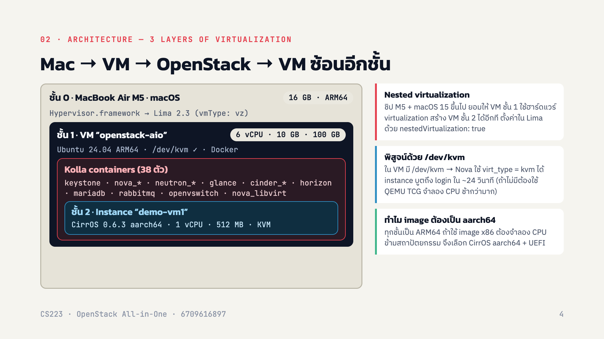
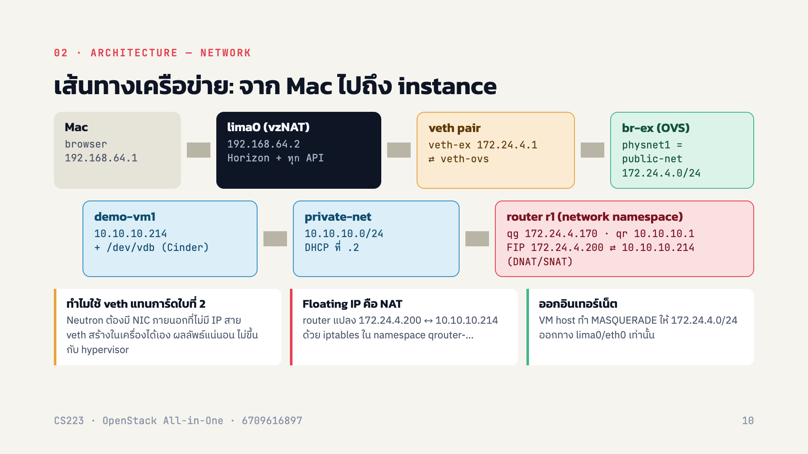

# OpenStack All-in-One ด้วย Kolla Ansible บน Virtual Machine

โปรเจกต์รายวิชา **CS223 Virtualization Technology** (มหาวิทยาลัยธรรมศาสตร์) — ติดตั้งและบริหาร OpenStack 2026.1 แบบ All-in-One (1 controller) ด้วย Kolla Ansible ภายใน VM (Ubuntu 24.04 ARM64) ที่สร้างด้วย Lima บน MacBook Air Apple M5 โดยใช้ nested virtualization ให้ Nova สร้าง instance ด้วย KVM

ผู้จัดทำ: ศุภณัฐ จันทร์เลข (6709616897)

## สถาปัตยกรรม

Mac (ชั้น 0) → Lima VM `openstack-aio` (ชั้น 1, Docker + Kolla containers) → instance `demo-vm1` (ชั้น 2, KVM)




## ผลลัพธ์

- `kolla-ansible deploy` สำเร็จ: `ok=322 failed=0`
- บริการ: Keystone, Glance, Nova, Placement, Neutron (OVS), Horizon, Cinder (LVM)
- instance ping/SSH ผ่าน floating IP ได้ บูตถึง login ราว 24 วินาที
- Bonus: OpenStack Swift (ติดตั้งจาก apt เพราะ Kolla Ansible ตัด role นี้แล้ว) เชื่อมกับ Keystone
- บันทึกปัญหา 13 เรื่อง พร้อมสาเหตุและวิธีแก้ใน [docs/INSTALL_LOG.md](docs/INSTALL_LOG.md)

## โครงสร้างโฟลเดอร์

```
.
├── lima/
│   └── openstack-aio.yaml        # นิยาม VM (vz + nestedVirtualization)
├── scripts/
│   ├── 01-prepare-host.sh        # swap, veth pair, NAT
│   ├── 02-install-kolla.sh       # Kolla Ansible, Cinder LVM, globals.yml
│   ├── 05-demo-resources.sh      # image, flavor, network, instance, volume
│   └── 06-swift.sh               # Swift (Bonus)
├── docs/
│   ├── INSTALL_LOG.md            # บันทึกการติดตั้งและปัญหาทั้ง 13 เรื่อง
│   ├── commands/                 # คู่มือคำสั่ง (VM, ตรวจสถานะ, admin, troubleshooting)
│   └── images/                   # แผนภาพสถาปัตยกรรม
└── evidence/
    ├── *.log                     # log จริงของแต่ละขั้นตอน
    └── screenshots/              # ภาพหน้าจอ Horizon
```

## วิธีใช้งานโดยย่อ

ต้องใช้ Mac ชิป M3 ขึ้นไป + macOS 15 ขึ้นไป (เพื่อ nested virtualization) และติดตั้ง [Lima](https://lima-vm.io) แล้ว

```bash
# บน Mac
limactl create --name=openstack-aio lima/openstack-aio.yaml
limactl start openstack-aio
limactl shell openstack-aio

# ใน VM — รันสคริปต์ตามลำดับ (รายละเอียดใน docs/INSTALL_LOG.md)
bash scripts/01-prepare-host.sh
bash scripts/02-install-kolla.sh
# จากนั้น kolla-ansible bootstrap-servers / prechecks / pull / deploy / post-deploy
bash scripts/05-demo-resources.sh
bash scripts/06-swift.sh      # Bonus
```

เปิด Horizon ที่ `http://192.168.64.2` (Domain `Default`, user `admin`; รหัสผ่านดูด้วย `grep keystone_admin_password /etc/kolla/passwords.yml` ใน VM)

คู่มือคำสั่งเพิ่มเติม: [docs/commands/README.md](docs/commands/README.md)

## หมายเหตุ

- รหัสผ่านใน `scripts/` (เช่น `Demo@12345`) เป็นรหัสของ user ทดลองในแล็บ ไม่ใช่ระบบจริง
- `/etc/kolla/passwords.yml` มีรหัสผ่านจริงของระบบ จึงไม่อยู่ใน repo
- ระบบ All-in-One นี้เหมาะกับการเรียนรู้เท่านั้น ไม่ใช่ production (ไม่มี HA, ใช้ test images จาก quay.io)
